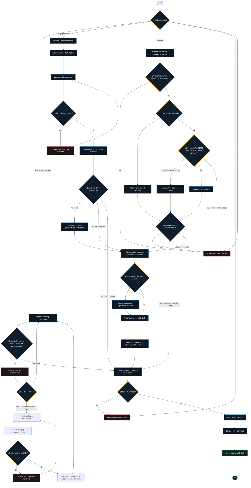

# Flujo de autenticación YES EMS

Este diagrama describe el comportamiento acordado: el código de correo sirve
para verificar la identidad y acceder a cuentas existentes. Si la cuenta es
nueva o todavía no tiene contraseña YES EMS, primero debe crearla. La contraseña
de Google nunca se solicita ni se modifica.

## Notas del flujo

- El código para iniciar sesión y el código de recuperación tienen propósitos
  distintos; no se pueden intercambiar.
- Una cuenta que ya tiene contraseña puede entrar con contraseña, código de
  correo o Google si este último está vinculado.
- Google se vincula a una cuenta existente solo cuando Google confirma el mismo
  correo y esa cuenta aún no está vinculada a otro `sub` de Google. No se
  fusionan registros duplicados.
- Los perfiles nuevos por correo completan nombre, apellidos y teléfono al
  establecer la primera contraseña. En Google, nombre y apellidos provienen del
  token verificado; el teléfono se solicita durante la inscripción al curso.
- Las cuentas administrativas usan su pantalla y autenticación separadas.
